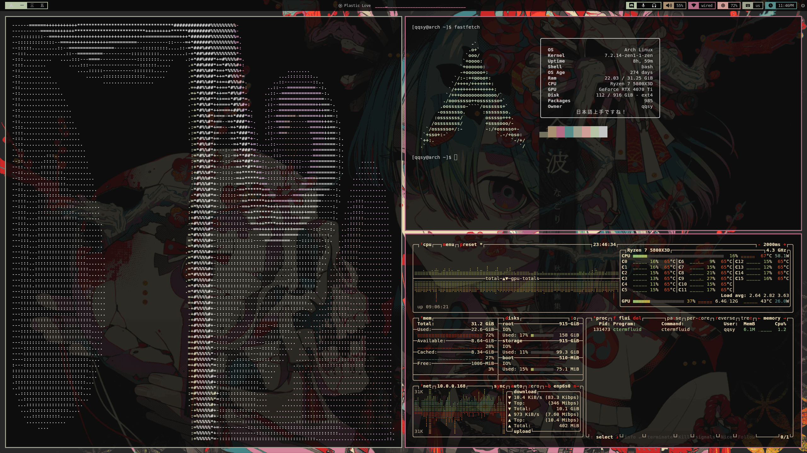
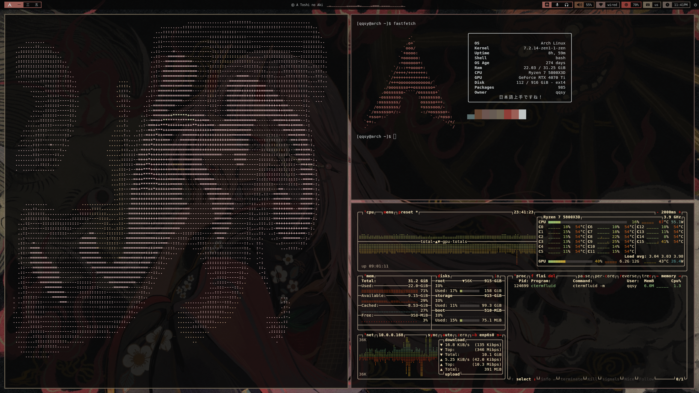

# CTermFluid

An ASCII fluid simulation the terminal, written in C with ncurses and based on [this article](https://shahriyarshahrabi.medium.com/gentle-introduction-to-fluid-simulation-for-programmers-and-technical-artists-7c0045c40bac).
Run a custom scene or use the mouse in a blank canvas.

## Showcase




```sh
ctermfluid                  # opposing colored plumes
ctermfluid -p crossflow     # diagonal jets program
ctermfluid -p rain          # rainbow rain program
ctermfluid -m               # empty canvas; left-drag to paint smoke
```

The visible grid supports up to **1024 columns × 512 rows**, providing headroom
for a fullscreen 3840×2160 terminal with a small font.

## Build

Building requires a C compiler, make, awk, and ncurses development libraries.

You will need an ncurses library installed

```sh
make
```

Build from the repository directory to find the bundled programs before installing.

```sh
make clean
```

## Install and uninstall

Build, then install to `/usr/bin`:

```sh
make
sudo make install
ctermfluid
```

The default prefix is `/usr`. Installation copies the executable to `/usr/bin`,
its manual to `/usr/share/man/man1`, and its MIT license to
`/usr/share/doc/ctermfluid/LICENSE`. It does not write configs into root's home.

For a different installation location, `PREFIX` is supported. 

```sh
sudo make uninstall
```

Uninstall preserves does not remove configs.

## Options

| Option | Effect |
| --- | --- |
| `-c`, `--no-color`, `--no-colour` | Disable color (enabled by default). |
| `--color`, `--colour` | Enable color explicitly, overriding an earlier `-c`. |
| `-f`, `--fps` | Show frame rate and simulation statistics. |
| `-F N`, `--max-fps N` | Cap rendering at 1–240 FPS; overrides the config (default 40). |
| `-m`, `--mouse` | Start empty and add smoke/velocity by dragging the left mouse button. |
| `-p`, `--program NAME\|FILE` | Select a named program or an explicit configuration file. |
| `-n`, `--no-dissipation` | Disable smoke fading, overriding the selected program. |
| `-t`, `--check-config` | Validate the selected configuration and exit without opening the terminal UI. |
| `-h`, `--help` | Show usage. |
| `-V`, `--version` | Show the version. |

## Program files

A program is a small `.conf` file. The default program is `default`; `crossflow` is also
included.

```sh
ctermfluid -p ./my-smoke.conf
ctermfluid -t -p ./my-smoke.conf
```

Named programs are searched in this order:

1. `$XDG_CONFIG_HOME/ctermfluid/NAME.conf`, or
   `$HOME/.config/ctermfluid/NAME.conf` when XDG_CONFIG_HOME is unset or relative.
2. `./programs/NAME.conf`, for running from the source directory.

To customize a program, copy it into your user program directory and select it by name.

```ini
[simulation]
max_fps = 40
dissipation = 0.05
viscosity = 0.0001
mouse_color = #00ffff

[source]
x = 0.5
y = 0.95
radius = 3
color = #00ffff
vx = 0
vy = -100
rate = 3
```

| Setting | Meaning | Default |
| --- | --- | --- |
| `max_fps` | Render FPS cap, integer `1`–`240`; simulation remains at 40 Hz. | `40` |
| `dissipation` | Exponential dye decay per second, `0`–`10`; `0` disables fading. | `0.05` |
| `viscosity` | Velocity diffusion, `0`–`1`. | `0.0001` |
| `mouse_color` | Mouse smoke color in `#RRGGBB` form. | `#00ffff` |
| `mouse_palette` | Optional terminal palette override for mouse smoke, integer `0`–`15`, used in mouse mode when color is enabled. | None |
| `x`, `y` | Source position, `0`–`1`. Left/top is `0`, right/bottom is `1`. | Required |
| `radius` | Square source radius in cells, integer `0`–`20`. | `3` |
| `color` | Source color in `#RRGGBB` form. | Required |
| `palette` | Optional terminal palette override, integer `0`–`15`, used when color is enabled. | None |
| `vx`, `vy` | Velocity added per second, `-1000`–`1000`; positive is right/down. | `0` |
| `rate` | Dye injection rate per second, `0`–`100`. | `3` |

## pywal

If you want to use [pywal](https://github.com/dylanaraps/pywal) for the palette, it should be supported by default since CTermFluid queries the terminal palette.
If this doesn't work, you can create a pywal template.

```ini
[simulation]
mouse_color = {color6}

[source]
x = 0.5
y = 0.95
color = {color2}
vy = -100
```

save it as `~/.config/wal/templates/ctermfluid.conf`, rerun wal, then do

```sh
ctermfluid -p ~/.cache/wal/ctermfluid.conf
```

## Releases

```sh
make clean all
make dist
```

## License

MIT, [View License](LICENSE).

